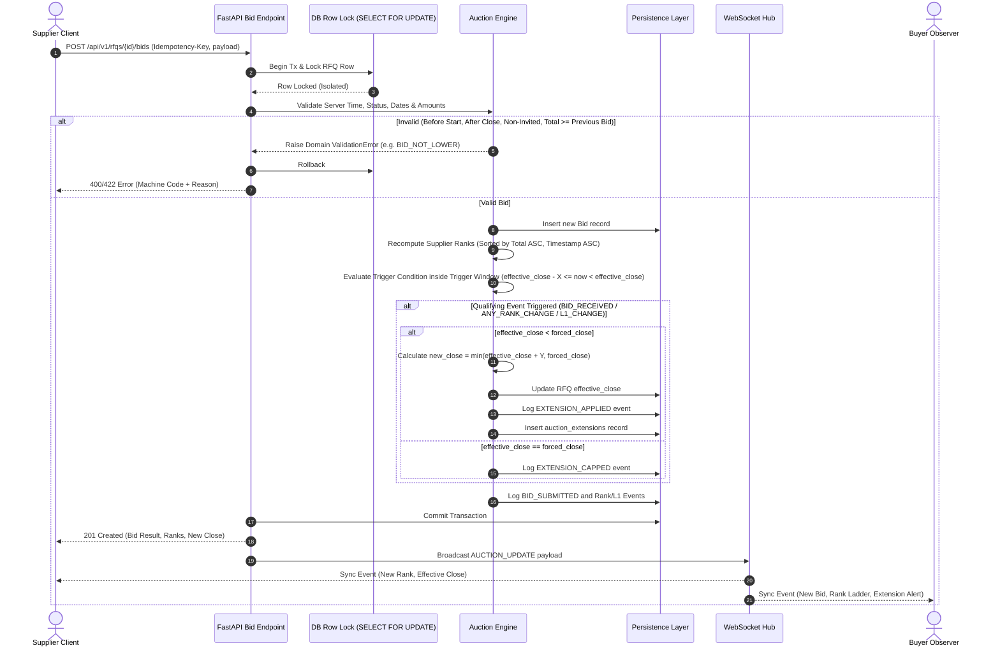

# MERIDIAN: British Auction RFQ Procurement Exchange
## High-Level Design (HLD) Architecture

### 1. Executive Summary & Core Concept
**MERIDIAN** is an enterprise-grade British Auction RFQ (Request for Quotation) procurement platform engineered for freight and logistics procurement. Unlike typical forward English auctions where prices ascend, or Dutch auctions where prices drop on a clock, a British Auction RFQ features a reverse auction where multiple invited suppliers submit competitive downward bids before a scheduled close. Crucially, it employs **dynamic auction extension rules** ("soft close") to deter "bid sniping" (last-second opportunistic bidding) while enforcing a strict **forced close** ceiling to ensure procurement decisions conclude predictably.

All auction logic, ranking algorithms, validation checks, qualification triggers, and timer modifications live strictly within the server-side transactional boundary.

---

### 2. High-Level Architecture

The system is architected as a modern decoupled full-stack application with real-time push capabilities and strict ACID transactional guarantees.

```mermaid
flowchart TB
    subgraph ClientLayer ["Client Layer (Web Application)"]
        UI_Buyer["Buyer Web App (React + TS + Tailwind)\n- Command Center\n- RFQ Builder\n- Live Auction Room\n- Audit & Analytics"]
        UI_Supplier["Supplier Web App (React + TS + Tailwind)\n- Portal & Invited RFQs\n- Live Bidding Console\n- Bid History & Rank Ladder"]
    end

    subgraph APILayer ["API & Real-Time Gateway (FastAPI)"]
        Router_Auth["Auth & JWT Router\nRole-Based Access Control"]
        Router_RFQ["RFQ & Config Router\nCRUD, Invites, Validation"]
        Router_Bid["Bid Processing Router\nIdempotency Guard"]
        Router_WS["WebSocket Gateway\nTopic Hub / Auction Channel"]
        Background_Sweeper["Auction State Sweeper (Async Engine)\nLazy & Periodic Status Transitions"]
    end

    subgraph EngineLayer ["Core Auction Engine (Server Boundary)"]
        LockManager["Pessimistic Concurrency Control\nSELECT FOR UPDATE (Row-Lock)"]
        Validator["Server-Time Rules Validator\nInvites, Bounds, Strictly Lower Bid"]
        RankEngine["Dynamic Rank Calculation Engine\nTotal Cost Ascending (L1 to Ln) + Timestamp Tie-Breaking"]
        TriggerEvaluator["Qualifying Event Evaluator\n- BID_RECEIVED\n- ANY_RANK_CHANGE\n- L1_CHANGE"]
        ExtensionEngine["Extension Calculator\nnew_close = min(effective_close + Y, forced_close)"]
        EventDispatcher["Transactional Event Logger\nAppend-Only Audit Trail"]
    end

    subgraph StorageLayer ["Persistence Layer"]
        DB[(PostgreSQL / SQLite Fallback)\nACID Transactions\nCHECK Constraints, Foreign Keys, Indexes]
    end

    UI_Buyer -->|REST / HTTPS| Router_Auth
    UI_Buyer -->|REST / HTTPS| Router_RFQ
    UI_Buyer <-->|WebSockets (WSS)| Router_WS
    
    UI_Supplier -->|REST / HTTPS| Router_Auth
    UI_Supplier -->|REST (POST /bids)| Router_Bid
    UI_Supplier <-->|WebSockets (WSS)| Router_WS

    Router_Bid --> LockManager
    LockManager --> Validator
    Validator --> RankEngine
    RankEngine --> TriggerEvaluator
    TriggerEvaluator --> ExtensionEngine
    ExtensionEngine --> EventDispatcher
    
    EventDispatcher -->|Commit Transaction| DB
    EventDispatcher -.->|Post-Commit Broadcast| Router_WS
    Background_Sweeper -->|Lazy Checks & Periodic Ticks| DB
    Background_Sweeper -.->|Emit AUCTION_CLOSED / FORCED_CLOSE| Router_WS
```

---

### 3. Component Deep Dive

#### 3.1 Backend Application Server (FastAPI + SQLAlchemy 2.x)
- **FastAPI**: Provides asynchronous endpoint handling, automatic OpenAPI schema generation, strict Pydantic v2 data validation, and native high-performance WebSockets.
- **Transactional Auction Engine**:
  - Encapsulated within `app/services/auction_engine.py`.
  - Every incoming bid runs inside an explicit transaction with pessimistic row-level locking (`with_for_update`) on the `rfqs` row.
  - Guarantees strict serialization: no two bids on the same auction can be evaluated simultaneously, preventing race conditions on ranking or trigger calculations.
  - Supports `Idempotency-Key` header with cached transaction responses to prevent duplicate submissions on flaky networks.
- **WebSocket Manager**:
  - Manages active client connections keyed by `rfq_id`.
  - Broadcasts structured event messages (`BID_SUBMITTED`, `RANK_CHANGED`, `L1_CHANGED`, `EXTENSION_APPLIED`, `EXTENSION_CAPPED`, `AUCTION_CLOSED`, `FORCED_CLOSE`).
  - Broadcasts include high-precision server timestamps so frontend clients can calculate and compensate for network latency / client clock drift.
- **Auction State Daemon & Lazy Enforcer**:
  - An asynchronous background task checks auctions approaching transitions (`SCHEDULED` -> `ACTIVE` -> `CLOSED` or `FORCE_CLOSED`).
  - In addition, all bid and read requests evaluate auction status lazily using `utcnow()`, guaranteeing that even if a background tick experiences latency, bids after the effective close are rejected immediately with zero tolerance.
- **Contract Award & Audit Export Subsystems**:
  - `POST /api/v1/rfqs/{id}/award`: Concludes the procurement cycle by officially awarding the contract to the chosen carrier, emitting an `AWARD_CONFIRMED` event and pushing notifications over WebSockets.
  - `GET /api/v1/rfqs/{id}/export-csv`: Streams a compliant RFC 4180 CSV audit trail of all historical quotes for external ERP/TMS ingestion.

#### 3.2 Frontend Application (React 18 + TypeScript + Vite + Tailwind CSS)
- **Design Philosophy**: Financial trading desk & industrial control terminal aesthetic (**MERIDIAN Design System**). High data density, Space Grotesk / Inter / IBM Plex Mono typography, razor-sharp hairline borders, zero frivolous glassmorphism.
- **Three-Zone Live Auction Room**:
  1. *Zone 1 (Left)*: RFQ shipment specifications, pickup dates, origin/destination, supplier's current quote breakdown.
  2. *Zone 2 (Center)*: Drift-compensated live millisecond countdown, current lowest bid, effective and forced close indicators, dynamic extension banner, and structured bid entry form with live total computation.
  3. *Zone 3 (Right)*: Live supplier rank ladder (L1, L2, L3...) with change animations, supplier's personal bid audit log, and real-time activity feed.
- **Synchronized Clock & Drift Compensation**:
  - The client records server timestamps provided on connection and on every WebSocket broadcast.
  - Formula: $\Delta = t_{\text{server}} - t_{\text{client\_receive}} - \frac{RTT}{2}$.
  - Millisecond countdown tick evaluates against $t_{\text{now}} + \Delta$ to guarantee exact alignment with server cutoff time.

---

### 4. Auction Rule Enforcement Workflow



---

### 5. Security & Multi-Tenancy Architecture
1. **Authentication**: JWT bearer tokens signed with cryptographic HMAC-SHA256, carrying identity, organization ID, and role (`buyer` vs `supplier`).
2. **Access Control (RBAC)**:
   - Buyers can create RFQs, invite suppliers, inspect all bids, and view platform-wide analytics.
   - Suppliers can only view RFQs to which their organization has an active invitation record (`rfq_invitations`).
   - Suppliers can only submit bids for their own authenticated supplier profile.
3. **Pessimistic Concurrency Control**:
   - Every bid acquisition leverages row-level locking (`with_for_update()`) on Postgres, guaranteeing complete isolation during rank evaluation and extension application.
   - SQLite fallback uses database-level transactions with immediate lock handling.
4. **Idempotency Guard**:
   - An in-memory/database idempotency registry hashes incoming `Idempotency-Key` headers along with user tokens, returning cached results on duplicate network transmissions.

