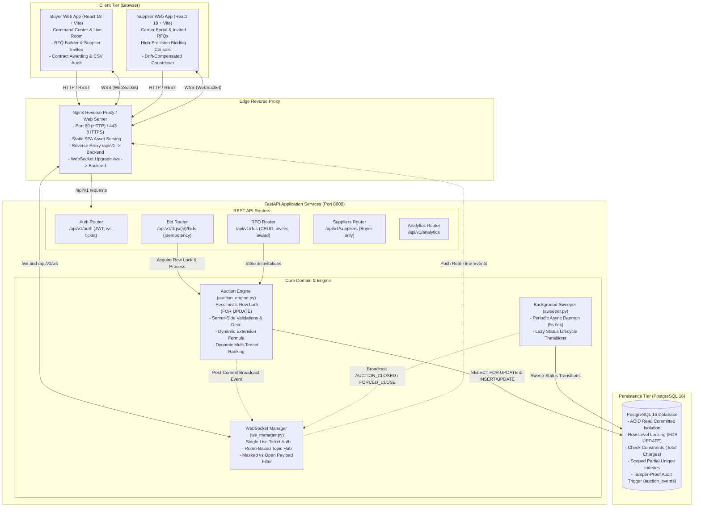
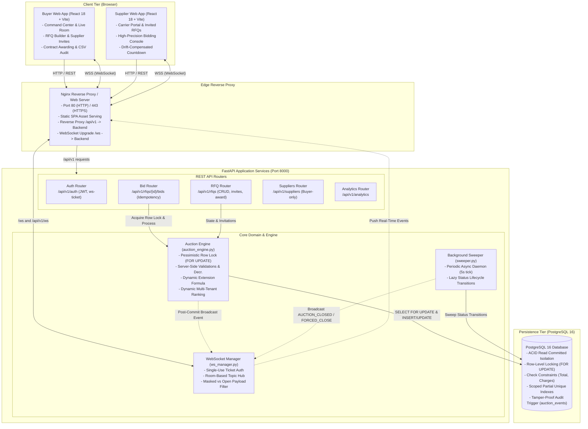
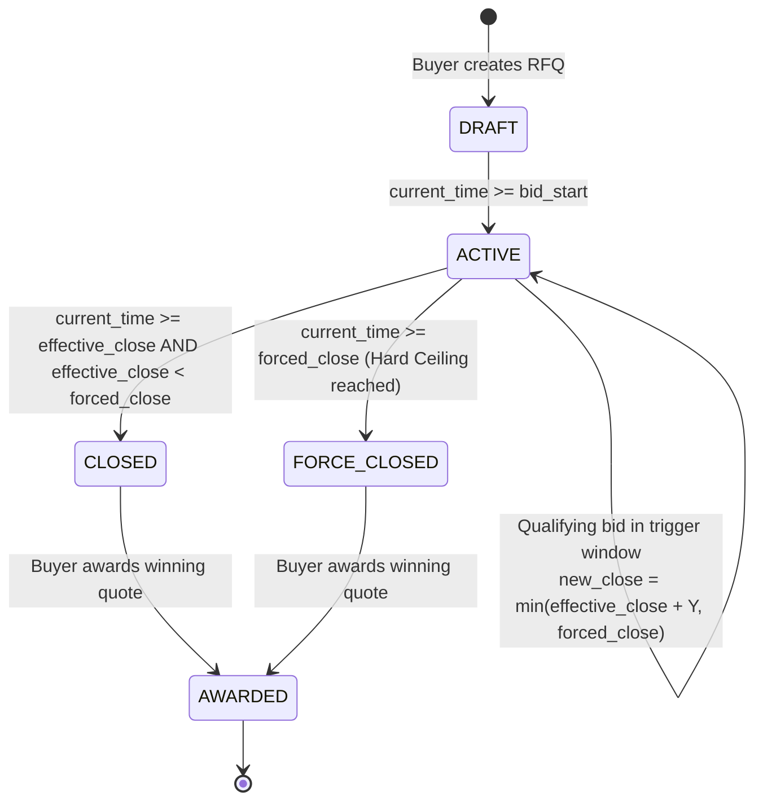
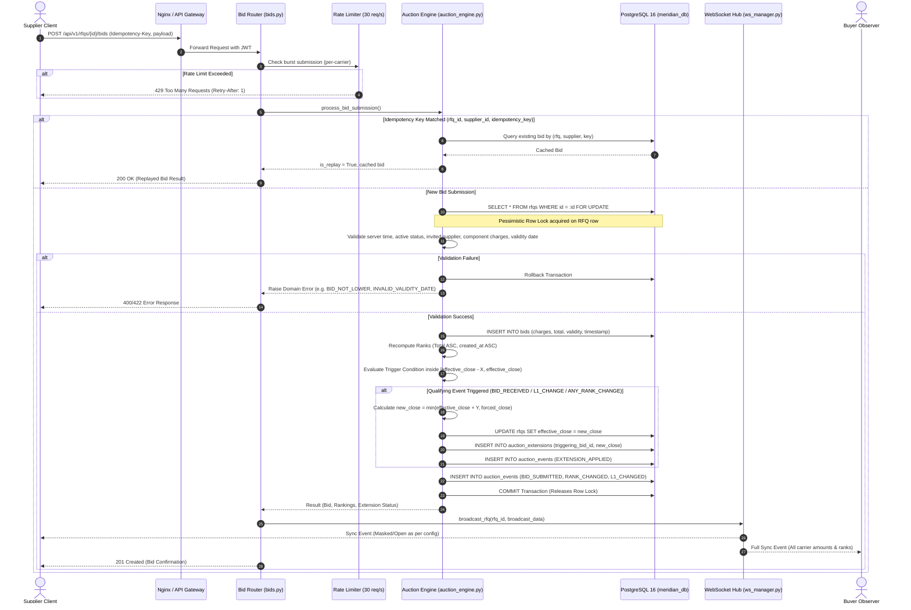

# MERIDIAN: British Auction RFQ Procurement Exchange
## High-Level Design (HLD) Architecture

---

### 1. Purpose & Domain Overview
**MERIDIAN** is an enterprise-grade British Auction RFQ (Request for Quotation) procurement platform engineered specifically for ocean container shipping and air freight logistics. In freight procurement, freight forwarders and shippers require competitive pricing while eliminating predatory bidding practices.

Unlike standard English forward auctions (ascending price) or Dutch auctions (clock-driven descending price), a **British Auction RFQ** operates as a reverse auction where invited carriers submit descending price quotes against an authoritative server deadline. 

Key operational imperatives addressed by MERIDIAN include:
1. **Anti-Sniping Dynamic Extension ("Soft Close")**: Opportunistic bots submit bids milliseconds before deadline to deny rivals reaction time. When a qualifying bid is submitted within the last $X$ minutes (trigger window), the auction dynamically extends by $Y$ minutes.
2. **Deterministic Hard Ceiling ("Forced Close")**: To prevent indefinite extensions and guarantee business closure, an absolute inviolable deadline (`forced_close`) caps all extensions:
   $$\text{new\_close} = \min(\text{effective\_close} + Y, \text{forced\_close})$$
3. **Multi-Tenant Privacy Modes**: Configurable per-RFQ visibility (`OPEN` transparent pricing vs. `MASKED` blind pricing where rival carriers only see their own rank and L1 price).
4. **Tamper-Proof Audit Trail**: Immutable append-only audit trail enforced by database-level triggers to guarantee compliance with commercial procurement regulations.

All ranking algorithms, validation rules, timer calculations, and concurrency controls execute strictly within the server-side transactional boundary.

---

### 2. High-Level System Architecture

The MERIDIAN platform is structured across four tiers: Client Application, Reverse Proxy Edge, Application Services (FastAPI), and Relational Persistence (PostgreSQL 16).





---

### 3. British Auction Domain Rules

#### 3.1 Initial Auction Configuration
Every British Auction RFQ contains explicit timing parameters:
- `bid_start`: Earliest moment bids are accepted.
- `bid_close`: Initial scheduled auction close deadline.
- `effective_close`: Dynamic current close deadline (initialized to `bid_close`).
- `forced_close`: Inviolable hard ceiling beyond which no extensions can push the auction.
- `trigger_window_minutes` ($X$): Time window before `effective_close` during which qualifying bids trigger an extension.
- `extension_minutes` ($Y$): Duration added to the close time upon a qualifying bid.
- `trigger_type`: Event condition required to trigger an extension.
- `min_decrement`: Minimum downward step required below carrier's prior quote (default: \$0.01).
- `bid_visibility`: Carrier privacy setting (`OPEN` vs. `MASKED`).

#### 3.2 Dynamic Extension Formula
When a qualifying bid is submitted inside the trigger window $[ \text{effective\_close} - X, \text{effective\_close} )$, the engine computes:
$$\text{new\_close} = \min(\text{effective\_close} + Y, \text{forced\_close})$$
**Strict Implementation Rule**: The formula strictly anchors to $\text{effective\_close} + Y$ (never $\text{now} + Y$). If $\text{effective\_close} + Y > \text{forced\_close}$, the extension is clamped to `forced_close`, and an `EXTENSION_CAPPED` event is emitted. Once $\text{effective\_close} == \text{forced\_close}$, no further extensions can occur.

#### 3.3 Qualifying Trigger Types
1. **`BID_RECEIVED`**: Any valid bid inside the trigger window qualifies and triggers an extension.
2. **`L1_CHANGE`**: Qualifies only if the identity of the lowest total bidder (L1) changes. The first bid on an auction qualifies as it establishes the initial L1.
3. **`ANY_RANK_CHANGE`**: Strictly defined as **an existing supplier's position changed after re-ranking**. The very first bid on an auction and a new bottom entrant who takes the lowest rank without disturbing any previously ranked supplier's position do **not** qualify.

#### 3.4 Monotonic Price Improvement & Component Charges
- A carrier's subsequent bid must improve upon their own previous best bid by at least `min_decrement`:
  $$\text{new\_total} \le \text{previous\_best\_total} - \text{min\_decrement}$$
- Component constraints enforced at database and application level:
  $$\text{freight\_charges} > 0, \quad \text{origin\_charges} \ge 0, \quad \text{destination\_charges} \ge 0$$
  $$\text{total} = \text{freight\_charges} + \text{origin\_charges} + \text{destination\_charges}$$
- Quote validity date must satisfy: $\text{quote\_validity\_date} \ge \text{rfq.pickup\_date}$.

#### 3.5 Auction Status Lifecycle



- **`DRAFT`**: Configured by buyer; invitations managed; parameters editable via `PATCH /rfqs/{id}`.
- **`ACTIVE`**: Auction is open for bidding. Modifications to dates, origin, destination, or pricing parameters are strictly rejected.
- **`CLOSED`**: Concluded normally when $\text{current\_time} \ge \text{effective\_close}$ and $\text{effective\_close} < \text{forced\_close}$.
- **`FORCE_CLOSED`**: Concluded because the auction reached its inviolable `forced_close` ceiling.
- **`AWARDED`**: Contract finalized and awarded to the selected supplier via `POST /rfqs/{id}/award`.

---

### 4. Bid Transaction & Concurrency Architecture

#### 4.1 Pessimistic Concurrency & Transaction Isolation
To prevent race conditions during simultaneous last-second bids (e.g. 20 concurrent carrier submissions), MERIDIAN employs **Pessimistic Row-Level Locking** on the target RFQ row:
1. Transaction runs at PostgreSQL default isolation level: **`READ COMMITTED`**.
2. Lock is acquired at `app/services/auction_engine.py:43` via:
   ```python
   query = db.query(RFQ).filter(RFQ.id == rfq_id).with_for_update()
   rfq = query.first()
   ```
   This generates:
   ```sql
   SELECT ... FROM rfqs WHERE id = :rfq_id FOR UPDATE;
   ```
3. PostgreSQL serializes all competing transactions on that specific RFQ row. The first transaction executes ranking, checks the trigger window, updates `effective_close`, records events, and releases the lock on `db.commit()`. The second transaction then reads the freshly committed `effective_close` and re-evaluates ranking.

#### 4.2 Sequence Diagram: End-to-End Bid Submission



---

### 5. Access Control & Security Model

1. **Authentication**:
   - Stateless JWT tokens signed with HMAC-SHA256 containing `sub` (User ID), `email`, and `role`.
   - Passwords securely hashed with `bcrypt`.
2. **Role-Based Access Control (RBAC)**:
   - **`buyer`**: Can create and patch RFQs, invite suppliers, inspect all carrier bids, view global analytics, export CSV audit files, and award contracts.
   - **`supplier`**: Can only view RFQs they are invited to via `rfq_invitations`. Submissions are verified against `current_user.supplier_id`. Calling buyer-only routes (e.g. `GET /api/v1/suppliers`) returns `403 Forbidden`.
3. **Bid Visibility Privacy (`OPEN` vs. `MASKED`)**:
   - In `OPEN` auctions: All invited carriers receive transparent ladders with carrier names, ranks, and bid amounts.
   - In `MASKED` auctions: The server filters all REST and WebSocket payloads for suppliers. Invited carriers receive their own bid details, their own rank, and the current L1 price. Rival carrier names, breakdowns, and amounts are completely redacted server-side.
4. **WebSocket Single-Use Ticket Authentication**:
   - Browsers obtain an ephemeral single-use ticket via `POST /api/v1/auth/ws-ticket` using their Bearer JWT.
   - The ticket expires in 60 seconds and is consumed immediately on the initial WebSocket handshake frame `{"type": "auth", "ticket": "..."}`. Query parameter tokens are completely disabled.
5. **Rate Limiting**:
   - Per-carrier sliding window: Maximum 30 quote submissions per second per supplier (`429 Too Many Requests`).
   - Per-client general rate limiter: 120 requests per minute on standard REST browsing routes.

---

### 6. API Route Catalog

All routes are mounted under the `/api/v1` namespace (with top-level `/health` aliases).

| Method | Endpoint | Access Role | Description | Response Codes |
|---|---|---|---|---|
| `GET` | `/health` / `/api/v1/health` | Public | Database connectivity & dialect health check | `200` |
| `POST` | `/api/v1/auth/register` | Public | Register new user account | `201`, `400` |
| `POST` | `/api/v1/auth/login` | Public | Authenticate and obtain JWT access token | `200`, `401` |
| `GET` | `/api/v1/auth/me` | Authenticated | Retrieve current user profile and supplier info | `200`, `401` |
| `POST` | `/api/v1/auth/ws-ticket` | Authenticated | Generate single-use 60s WebSocket ticket | `200`, `401` |
| `GET` | `/api/v1/suppliers` | Buyer Only | List all registered freight suppliers | `200`, `403` |
| `GET` | `/api/v1/rfqs` | Authenticated | List RFQs (filtered to invited RFQs for suppliers) | `200` |
| `POST` | `/api/v1/rfqs` | Buyer Only | Create new RFQ with British auction configuration | `201`, `422` |
| `GET` | `/api/v1/rfqs/{id}` | Invited / Buyer | Get RFQ details (payload masked if MASKED mode) | `200`, `403`, `404` |
| `PATCH` | `/api/v1/rfqs/{id}` | Buyer Only | Update draft RFQ (rejected in ACTIVE/CLOSED) | `200`, `400`, `404` |
| `POST` | `/api/v1/rfqs/{id}/invitations` | Buyer Only | Invite supplier to RFQ | `201`, `400`, `404` |
| `DELETE` | `/api/v1/rfqs/{id}/invitations/{s_id}` | Buyer Only | Revoke supplier invitation | `204`, `400`, `404` |
| `POST` | `/api/v1/rfqs/{id}/award` | Buyer Only | Award RFQ to winning supplier quote | `200`, `400`, `404` |
| `GET` | `/api/v1/rfqs/{id}/export-csv` | Buyer Only | Export RFC 4180 audit trail CSV of bids | `200`, `403`, `404` |
| `POST` | `/api/v1/rfqs/{id}/reseed-demo` | Public / Dev | Reset demo RFQ to active state with 30m window | `200` |
| `POST` | `/api/v1/rfqs/{id}/bids` | Invited Supplier | Submit quote (with Idempotency-Key support) | `200`, `201`, `400`, `403`, `422`, `429` |
| `GET` | `/api/v1/rfqs/{id}/bids` | Invited / Buyer | List bids for RFQ (masked for rival suppliers) | `200`, `403`, `404` |
| `GET` | `/api/v1/rfqs/{id}/events` | Invited / Buyer | List audit events for RFQ | `200`, `403`, `404` |
| `GET` | `/api/v1/analytics/command-center` | Buyer Only | Aggregated KPIs for buyer dashboard | `200`, `403` |
| `GET` | `/api/v1/analytics/supplier-portal`| Supplier Only | Performance KPIs for carrier portal | `200`, `403` |
| `WS` | `/ws/rfqs/{id}` | Authenticated | Real-time auction room event stream | `1000`, `4003` |

---

### 7. Deployment Architecture

#### 7.1 Docker Compose Deployment
The standard production stack is orchestrated via `docker-compose.yml`:
- **`db`**: PostgreSQL 16 container (`postgres:16-alpine`), internal port 5432, exposed on `${POSTGRES_PORT:-5432}:5432`. Data persisted in `postgres_data` volume. Healthcheck: `pg_isready -U meridian -d meridian_db`.
- **`backend`**: FastAPI application running on Uvicorn (`app.main:app`), internal port 8000, exposed on `8000:8000`. Depends on healthy `db`.
- **`frontend`**: React Vite SPA served via Nginx on port 80 (or development dev server on 5173). Reverse proxies `/api` and `/ws` to the backend container.

#### 7.2 Native Development & Makefile
- Native virtual environment: `.venv/bin/uvicorn app.main:app --host 0.0.0.0 --port 8000 --reload`
- Make targets:
  - `make dev`: Launches background backend and frontend Vite dev servers.
  - `make test-backend`: Executes Pytest suite against PostgreSQL test database.
  - `make test-frontend`: Executes Vitest client validation suite.
  - `make seed`: Seeds baseline buyers, suppliers, and sample RFQs.
  - `make demo`: Seeds authoritative live demonstration RFQs.
  - `make verify`: Executes comprehensive end-to-end verification (Pytest, Vitest, 20-parallel concurrent bids, tamper-proof trigger test).

---

### 8. Known Limitations & Architecture Decisions

1. **In-Process WebSocket Pub/Sub**:
   - `ConnectionManager` stores active WebSockets in an in-memory dictionary.
   - *Limitation*: For horizontal scaling across multiple backend worker nodes, a Redis Pub/Sub adapter would be required to synchronize broadcasts across instances.
2. **In-Memory Rate Limiting**:
   - Sliding-window rate limiters store timestamps in memory per process.
   - *Limitation*: Rate limits apply per Uvicorn worker process. In distributed multi-worker deployments, a Redis-backed sliding window counter is recommended.
3. **In-Process State Sweeper**:
   - An asynchronous background task runs every 5 seconds inside the FastAPI process to sweep expired auctions.
   - *Architecture Guarantee*: Lazy evaluation on every read and write request ensures that even if the background sweeper experiences jitter, bids submitted past `effective_close` are rejected with zero tolerance. In large-scale deployments, Celery Beat or `pg_cron` can be utilized.
4. **Transaction Isolation Level**:
   - MERIDIAN deliberately operates on PostgreSQL `READ COMMITTED` paired with explicit `SELECT ... FOR UPDATE` pessimistic locks. This avoids `SERIALIZABLE` retry transaction aborts while guaranteeing strict serial execution on a per-auction basis.
