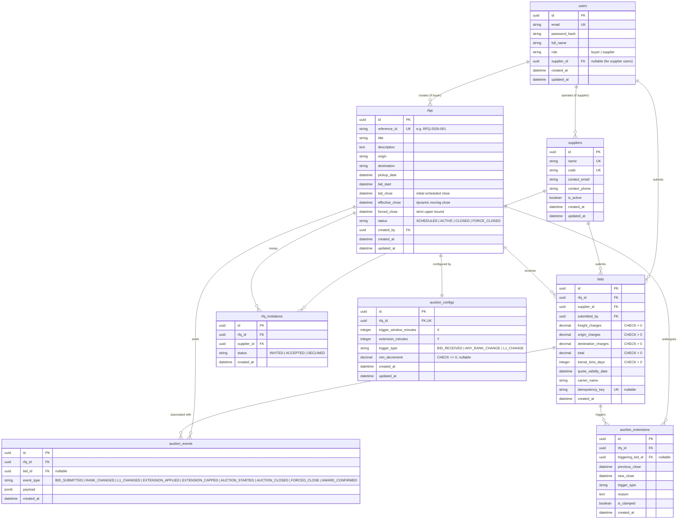

# MERIDIAN: Database Schema Specification

## 1. Entity-Relationship Diagram (ERD)

---

## 2. Table Specifications & Constraints

### 2.1 `users`
Stores user identities and roles.
- `id`: UUID, Primary Key.
- `email`: VARCHAR(255), Unique, Not Null.
- `password_hash`: VARCHAR(255), Not Null.
- `full_name`: VARCHAR(255), Not Null.
- `role`: VARCHAR(20), Not Null. Enum: `'buyer'`, `'supplier'`.
- `supplier_id`: UUID, Foreign Key to `suppliers.id`, Nullable (set only for supplier accounts).
- `created_at`, `updated_at`: TIMESTAMPTZ, Not Null.

### 2.2 `suppliers`
Supplier organizations invited to bid.
- `id`: UUID, Primary Key.
- `name`: VARCHAR(255), Unique, Not Null.
- `code`: VARCHAR(50), Unique, Not Null (e.g., `SUP-MAERSK`, `SUP-HAPAG`).
- `contact_email`: VARCHAR(255), Not Null.
- `contact_phone`: VARCHAR(50), Nullable.
- `is_active`: BOOLEAN, Default `true`.

### 2.3 `rfqs`
The core Request for Quotation entity.
- `id`: UUID, Primary Key.
- `reference_id`: VARCHAR(64), Unique, Not Null (e.g., `RFQ-2026-X88`).
- `title`: VARCHAR(255), Not Null.
- `description`: TEXT, Nullable.
- `origin`: VARCHAR(255), Not Null (e.g. `Shanghai (CNSHA)`).
- `destination`: VARCHAR(255), Not Null (e.g. `Rotterdam (NLRTM)`).
- `pickup_date`: TIMESTAMPTZ, Not Null.
- `bid_start`: TIMESTAMPTZ, Not Null.
- `bid_close`: TIMESTAMPTZ, Not Null.
- `effective_close`: TIMESTAMPTZ, Not Null.
- `forced_close`: TIMESTAMPTZ, Not Null.
- `status`: VARCHAR(20), Not Null. Enum: `'SCHEDULED'`, `'ACTIVE'`, `'CLOSED'`, `'FORCE_CLOSED'`.
- `created_by`: UUID, Foreign Key to `users.id`.
- **CHECK Constraints**:
  - `CHECK (forced_close > bid_close)`
  - `CHECK (bid_close > bid_start)`
  - `CHECK (pickup_date > bid_close)`
  - `CHECK (effective_close <= forced_close)`
  - `CHECK (effective_close >= bid_close)`

### 2.4 `auction_configs`
British auction timing and trigger configuration.
- `id`: UUID, Primary Key.
- `rfq_id`: UUID, Unique, Foreign Key to `rfqs.id` ON DELETE CASCADE.
- `trigger_window_minutes`: INTEGER, Not Null (X). `CHECK (trigger_window_minutes > 0)`.
- `extension_minutes`: INTEGER, Not Null (Y). `CHECK (extension_minutes > 0)`.
- `trigger_type`: VARCHAR(30), Not Null. Enum: `'BID_RECEIVED'`, `'ANY_RANK_CHANGE'`, `'L1_CHANGE'`.
- `bid_visibility`: VARCHAR(20), Not Null, Default `'OPEN'`. Enum: `'OPEN'`, `'MASKED'`.
- `min_decrement`: NUMERIC(12, 2), Nullable, Default `0.00`. Optional minimum price decrement required below the supplier's previous bid. `CHECK (min_decrement >= 0)`.

### 2.5 `rfq_invitations`
Whitelist mapping which suppliers can inspect and participate in an RFQ.
- `id`: UUID, Primary Key.
- `rfq_id`: UUID, Foreign Key to `rfqs.id` ON DELETE CASCADE.
- `supplier_id`: UUID, Foreign Key to `suppliers.id` ON DELETE CASCADE.
- `status`: VARCHAR(20), Default `'INVITED'`.
- **Unique Constraint**: `UNIQUE(rfq_id, supplier_id)`.

### 2.6 `bids`
Immutable record of all bids submitted.
- `id`: UUID, Primary Key.
- `rfq_id`: UUID, Foreign Key to `rfqs.id` ON DELETE CASCADE.
- `supplier_id`: UUID, Foreign Key to `suppliers.id` ON DELETE CASCADE.
- `submitted_by`: UUID, Foreign Key to `users.id`.
- `freight_charges`: NUMERIC(12, 2), Not Null. `CHECK (freight_charges > 0)`.
- `origin_charges`: NUMERIC(12, 2), Not Null. `CHECK (origin_charges >= 0)`.
- `destination_charges`: NUMERIC(12, 2), Not Null. `CHECK (destination_charges >= 0)`.
- `total`: NUMERIC(12, 2), Not Null. `CHECK (total > 0)`.
- `transit_time_days`: INTEGER, Not Null. `CHECK (transit_time_days > 0)`.
- `quote_validity_date`: TIMESTAMPTZ, Not Null.
- `carrier_name`: VARCHAR(255), Not Null.
- `idempotency_key`: VARCHAR(128), Nullable, Unique.
- `created_at`: TIMESTAMPTZ, Not Null.
- **Indexes**:
  - `CREATE INDEX idx_bids_rfq_created ON bids(rfq_id, created_at);`
  - `CREATE INDEX idx_bids_rfq_total ON bids(rfq_id, total);`
  - `CREATE INDEX idx_bids_supplier_rfq ON bids(supplier_id, rfq_id, created_at DESC);`

### 2.7 `auction_extensions`
Audit record of all extension decisions made by the auction engine.
- `id`: UUID, Primary Key.
- `rfq_id`: UUID, Foreign Key to `rfqs.id` ON DELETE CASCADE.
- `triggering_bid_id`: UUID, Foreign Key to `bids.id`, Nullable.
- `previous_close`: TIMESTAMPTZ, Not Null.
- `new_close`: TIMESTAMPTZ, Not Null.
- `trigger_type`: VARCHAR(30), Not Null.
- `reason`: TEXT, Not Null.
- `is_clamped`: BOOLEAN, Not Null.
- `created_at`: TIMESTAMPTZ, Not Null.

### 2.8 `auction_events`
Append-only chronological audit log of all auction events.
- `id`: UUID, Primary Key.
- `rfq_id`: UUID, Foreign Key to `rfqs.id` ON DELETE CASCADE.
- `bid_id`: UUID, Foreign Key to `bids.id`, Nullable.
- `event_type`: VARCHAR(50), Not Null. Enum:
  `BID_SUBMITTED`, `RANK_CHANGED`, `L1_CHANGED`, `EXTENSION_APPLIED`, `EXTENSION_CAPPED`, `AUCTION_STARTED`, `AUCTION_CLOSED`, `FORCED_CLOSE`, `AWARD_CONFIRMED`.
- `payload`: JSONB / JSON, Not Null.
- `created_at`: TIMESTAMPTZ, Not Null.
- **Indexes**:
  - `CREATE INDEX idx_auction_events_rfq_created ON auction_events(rfq_id, created_at);`
  - `CREATE INDEX idx_rfqs_status_effective ON rfqs(status, effective_close);`
- **Tamper-Proof Trigger**:
  - `trg_prevent_audit_tampering` prevents any `UPDATE` or `DELETE` operations on this table, rejected at the database level with exception `Audit trail is append-only. UPDATE and DELETE operations are strictly prohibited on auction_events.`. Guaranteed immutable audit trail.

---

## 3. Standard API Error Status Agreement

All system endpoints, engine validations, and client responses adhere to the following unified HTTP status contract:

| Machine Error Code | HTTP Status | Domain Context & Trigger Condition |
| :--- | :---: | :--- |
| `SUPPLIER_NOT_INVITED` | **403 Forbidden** | Carrier account not present in `rfq_invitations` table for the specified RFQ. |
| `BID_NOT_LOWER` | **400 Bad Request** | Submitted bid total is equal to or higher than carrier's own previous best quote, or fails `min_decrement`. |
| `INVALID_VALIDITY_DATE` | **400 Bad Request** | Carrier quote validity date is prior to the RFQ pickup date. |
| `VALIDATION_ERROR` (`INVALID_BID_AMOUNT`) | **422 Unprocessable Entity** | Non-positive, zero, or invalid numeric values for `freight_charges`, `origin_charges`, or `destination_charges`. |
| `AUCTION_CLOSED` / `BID_AFTER_CLOSE` | **400 Bad Request** | Bid timestamp exceeds current `effective_close` or `forced_close`. |
| `BUYER_ROLE_REQUIRED` | **403 Forbidden** | Supplier token attempting to access buyer administrative or creation endpoints. |
| `INVALID_CREDENTIALS` | **401 Unauthorized** | Missing, malformed, or expired JWT token. |
| `RATE_LIMIT_EXCEEDED` | **429 Too Many Requests** | Exceeded burst limit of 10 requests within a 1-second sliding window. |

