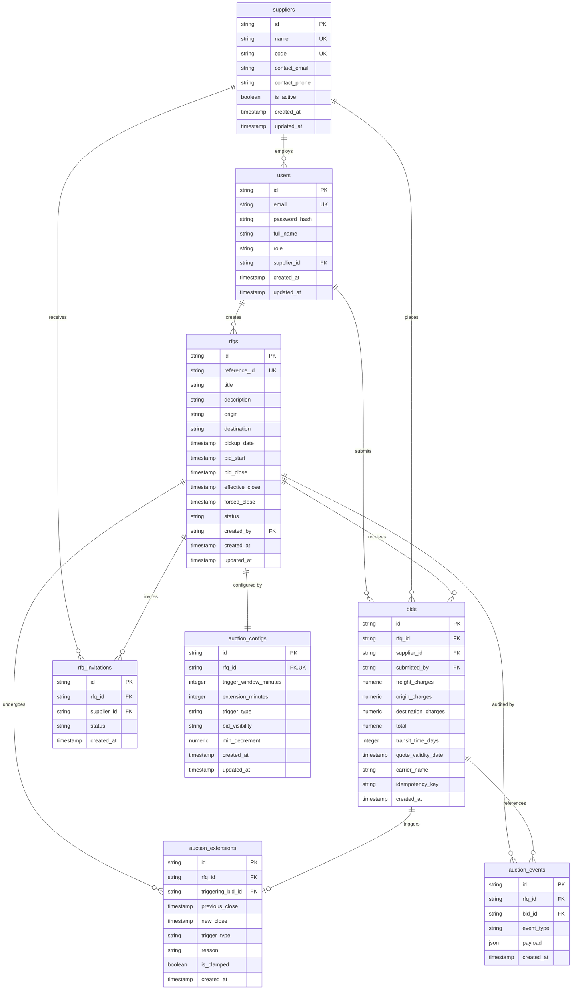

# MERIDIAN: Database Schema Design & Live PostgreSQL Specification

---

## 1. Overview & Source
This document details the authoritative relational database schema for the **MERIDIAN British Auction RFQ Procurement Exchange**. 

- **Target Engine**: PostgreSQL 16 (or higher, e.g. PostgreSQL 18.6)
- **Migration Framework**: Alembic (SQLAlchemy 2.x)
- **Current Alembic Revision**: `e5f6a1b2c3d4 (head)`
- **Schema Integrity**: Enforces ACID compliance, check constraints, foreign key referential integrity (`RESTRICT` on audits and triggering bids, `CASCADE` on child entities), partial composite unique indexes, and an append-only database trigger on `auction_events`.

---

## 2. Entity-Relationship Diagram (ERD)



---

## 3. Database Tables Overview

| Table Name | Primary Key | Purpose | Key Constraints & Integrity Rules |
|---|---|---|---|
| **`users`** | `id` (UUIDv4) | User identity, credentials, roles (`buyer`, `supplier`) | Unique email; FK to `suppliers` on delete `SET NULL` |
| **`suppliers`** | `id` (UUIDv4) | Carrier organizations invited to RFQs | Unique `code` and `name` |
| **`rfqs`** | `id` (UUIDv4) | Request for Quotation auction containers | Unique `reference_id`; `bid_close > bid_start`; `forced_close > bid_close`; `pickup_date > bid_close` |
| **`auction_configs`** | `id` (UUIDv4) | Auction rules and anti-sniping parameters | 1-to-1 with `rfqs`; `trigger_window_minutes > 0`; `extension_minutes > 0` |
| **`rfq_invitations`** | `id` (UUIDv4) | Whitelist of carriers invited to participate | Unique composite `(rfq_id, supplier_id)`; Cascade delete |
| **`bids`** | `id` (UUIDv4) | Submitted carrier freight price quotes | `freight > 0`; `origin >= 0`; `destination >= 0`; `total > 0`; `total = freight + origin + destination`; partial unique index `(rfq_id, supplier_id, idempotency_key)` |
| **`auction_extensions`**| `id` (UUIDv4) | Audit record of dynamic soft-close extensions | `triggering_bid_id` `NOT NULL` with FK `ON DELETE RESTRICT`; FK to `rfqs` |
| **`auction_events`** | `id` (UUIDv4) | Immutable append-only auction audit trail | FK `bid_id` `ON DELETE RESTRICT`; **Append-only trigger `trg_prevent_audit_tampering`** blocks `UPDATE`/`DELETE` |
| **`alembic_version`** | `version_num` | Migration state tracker | Managed by Alembic; current head `e5f6a1b2c3d4` |

---

## 4. Live Table Definitions (`\d+`)

### 4.1 `users`
```text
                                                      Table "public.users"
    Column     |           Type           | Collation | Nullable | Default | Storage  | Compression | Stats target | Description 
---------------+--------------------------+-----------+----------+---------+----------+-------------+--------------+-------------
 id            | character varying(36)    |           | not null |         | extended |             |              | 
 email         | character varying(255)   |           | not null |         | extended |             |              | 
 password_hash | character varying(255)   |           | not null |         | extended |             |              | 
 full_name     | character varying(255)   |           | not null |         | extended |             |              | 
 role          | character varying(20)    |           | not null |         | extended |             |              | 
 supplier_id   | character varying(36)    |           |          |         | extended |             |              | 
 created_at    | timestamp with time zone |           | not null |         | plain    |             |              | 
 updated_at    | timestamp with time zone |           | not null |         | plain    |             |              | 
Indexes:
    "users_pkey" PRIMARY KEY, btree (id)
    "ix_users_email" UNIQUE, btree (email)
Foreign-key constraints:
    "users_supplier_id_fkey" FOREIGN KEY (supplier_id) REFERENCES suppliers(id) ON DELETE SET NULL
Referenced by:
    TABLE "bids" CONSTRAINT "bids_submitted_by_fkey" FOREIGN KEY (submitted_by) REFERENCES users(id) ON DELETE RESTRICT
    TABLE "rfqs" CONSTRAINT "rfqs_created_by_fkey" FOREIGN KEY (created_by) REFERENCES users(id) ON DELETE RESTRICT
```

### 4.2 `suppliers`
```text
                                                    Table "public.suppliers"
    Column     |           Type           | Collation | Nullable | Default | Storage  | Compression | Stats target | Description 
---------------+--------------------------+-----------+----------+---------+----------+-------------+--------------+-------------
 id            | character varying(36)    |           | not null |         | extended |             |              | 
 name          | character varying(255)   |           | not null |         | extended |             |              | 
 code          | character varying(50)    |           | not null |         | extended |             |              | 
 contact_email | character varying(255)   |           | not null |         | extended |             |              | 
 contact_phone | character varying(50)    |           |          |         | extended |             |              | 
 is_active     | boolean                  |           | not null |         | plain    |             |              | 
 created_at    | timestamp with time zone |           | not null |         | plain    |             |              | 
 updated_at    | timestamp with time zone |           | not null |         | plain    |             |              | 
Indexes:
    "suppliers_pkey" PRIMARY KEY, btree (id)
    "ix_suppliers_code" UNIQUE, btree (code)
    "suppliers_name_key" UNIQUE CONSTRAINT, btree (name)
Referenced by:
    TABLE "bids" CONSTRAINT "bids_supplier_id_fkey" FOREIGN KEY (supplier_id) REFERENCES suppliers(id) ON DELETE CASCADE
    TABLE "rfq_invitations" CONSTRAINT "rfq_invitations_supplier_id_fkey" FOREIGN KEY (supplier_id) REFERENCES suppliers(id) ON DELETE CASCADE
    TABLE "users" CONSTRAINT "users_supplier_id_fkey" FOREIGN KEY (supplier_id) REFERENCES suppliers(id) ON DELETE SET NULL
```

### 4.3 `rfqs`
```text
                                                        Table "public.rfqs"
     Column      |           Type           | Collation | Nullable | Default | Storage  | Compression | Stats target | Description 
-----------------+--------------------------+-----------+----------+---------+----------+-------------+--------------+-------------
 id              | character varying(36)    |           | not null |         | extended |             |              | 
 reference_id    | character varying(64)    |           | not null |         | extended |             |              | 
 title           | character varying(255)   |           | not null |         | extended |             |              | 
 description     | text                     |           |          |         | extended |             |              | 
 origin          | character varying(255)   |           | not null |         | extended |             |              | 
 destination     | character varying(255)   |           | not null |         | extended |             |              | 
 pickup_date     | timestamp with time zone |           | not null |         | plain    |             |              | 
 bid_start       | timestamp with time zone |           | not null |         | plain    |             |              | 
 bid_close       | timestamp with time zone |           | not null |         | plain    |             |              | 
 effective_close | timestamp with time zone |           | not null |         | plain    |             |              | 
 forced_close    | timestamp with time zone |           | not null |         | plain    |             |              | 
 status          | character varying(20)    |           | not null |         | extended |             |              | 
 created_by      | character varying(36)    |           | not null |         | extended |             |              | 
 created_at      | timestamp with time zone |           | not null |         | plain    |             |              | 
 updated_at      | timestamp with time zone |           | not null |         | plain    |             |              | 
Indexes:
    "rfqs_pkey" PRIMARY KEY, btree (id)
    "idx_rfqs_status_effective" btree (status, effective_close)
    "ix_rfqs_reference_id" UNIQUE, btree (reference_id)
Check constraints:
    "chk_bid_close_gt_bid_start" CHECK (bid_close > bid_start)
    "chk_forced_close_gt_bid_close" CHECK (forced_close > bid_close)
    "chk_pickup_date_gt_bid_close" CHECK (pickup_date > bid_close)
Foreign-key constraints:
    "rfqs_created_by_fkey" FOREIGN KEY (created_by) REFERENCES users(id) ON DELETE RESTRICT
Referenced by:
    TABLE "auction_configs" CONSTRAINT "auction_configs_rfq_id_fkey" FOREIGN KEY (rfq_id) REFERENCES rfqs(id) ON DELETE CASCADE
    TABLE "auction_events" CONSTRAINT "auction_events_rfq_id_fkey" FOREIGN KEY (rfq_id) REFERENCES rfqs(id) ON DELETE CASCADE
    TABLE "auction_extensions" CONSTRAINT "auction_extensions_rfq_id_fkey" FOREIGN KEY (rfq_id) REFERENCES rfqs(id) ON DELETE CASCADE
    TABLE "bids" CONSTRAINT "bids_rfq_id_fkey" FOREIGN KEY (rfq_id) REFERENCES rfqs(id) ON DELETE CASCADE
    TABLE "rfq_invitations" CONSTRAINT "rfq_invitations_rfq_id_fkey" FOREIGN KEY (rfq_id) REFERENCES rfqs(id) ON DELETE CASCADE
```

### 4.4 `auction_configs`
```text
                                                  Table "public.auction_configs"
         Column         |           Type           | Collation | Nullable | Default | Storage  | Compression | Stats target | Description 
------------------------+--------------------------+-----------+----------+---------+----------+-------------+--------------+-------------
 id                     | character varying(36)    |           | not null |         | extended |             |              | 
 rfq_id                 | character varying(36)    |           | not null |         | extended |             |              | 
 trigger_window_minutes | integer                  |           | not null |         | plain    |             |              | 
 extension_minutes      | integer                  |           | not null |         | plain    |             |              | 
 trigger_type           | character varying(30)    |           | not null |         | extended |             |              | 
 bid_visibility         | character varying(20)    |           | not null |         | extended |             |              | 
 min_decrement          | numeric(12,2)            |           |          |         | main     |             |              | 
 created_at             | timestamp with time zone |           | not null |         | plain    |             |              | 
 updated_at             | timestamp with time zone |           | not null |         | plain    |             |              | 
Indexes:
    "auction_configs_pkey" PRIMARY KEY, btree (id)
    "auction_configs_rfq_id_key" UNIQUE CONSTRAINT, btree (rfq_id)
Check constraints:
    "chk_extension_minutes_pos" CHECK (extension_minutes > 0)
    "chk_trigger_window_pos" CHECK (trigger_window_minutes > 0)
Foreign-key constraints:
    "auction_configs_rfq_id_fkey" FOREIGN KEY (rfq_id) REFERENCES rfqs(id) ON DELETE CASCADE
```

### 4.5 `rfq_invitations`
```text
                                                 Table "public.rfq_invitations"
   Column    |           Type           | Collation | Nullable | Default | Storage  | Compression | Stats target | Description 
-------------+--------------------------+-----------+----------+---------+----------+-------------+--------------+-------------
 id          | character varying(36)    |           | not null |         | extended |             |              | 
 rfq_id      | character varying(36)    |           | not null |         | extended |             |              | 
 supplier_id | character varying(36)    |           | not null |         | extended |             |              | 
 status      | character varying(20)    |           | not null |         | extended |             |              | 
 created_at  | timestamp with time zone |           | not null |         | plain    |             |              | 
Indexes:
    "rfq_invitations_pkey" PRIMARY KEY, btree (id)
    "idx_invitations_rfq" btree (rfq_id)
    "idx_invitations_supplier" btree (supplier_id)
    "uq_rfq_supplier_invitation" UNIQUE CONSTRAINT, btree (rfq_id, supplier_id)
Foreign-key constraints:
    "rfq_invitations_rfq_id_fkey" FOREIGN KEY (rfq_id) REFERENCES rfqs(id) ON DELETE CASCADE
    "rfq_invitations_supplier_id_fkey" FOREIGN KEY (supplier_id) REFERENCES suppliers(id) ON DELETE CASCADE
```

### 4.6 `bids`
```text
                                                       Table "public.bids"
        Column        |           Type           | Collation | Nullable | Default | Storage  | Compression | Stats target | Description 
----------------------+--------------------------+-----------+----------+---------+----------+-------------+--------------+-------------
 id                   | character varying(36)    |           | not null |         | extended |             |              | 
 rfq_id               | character varying(36)    |           | not null |         | extended |             |              | 
 supplier_id          | character varying(36)    |           | not null |         | extended |             |              | 
 submitted_by         | character varying(36)    |           | not null |         | extended |             |              | 
 freight_charges      | numeric(12,2)            |           | not null |         | main     |             |              | 
 origin_charges       | numeric(12,2)            |           | not null |         | main     |             |              | 
 destination_charges  | numeric(12,2)            |           | not null |         | main     |             |              | 
 total                | numeric(12,2)            |           | not null |         | main     |             |              | 
 transit_time_days    | integer                  |           | not null |         | plain    |             |              | 
 quote_validity_date  | timestamp with time zone |           | not null |         | plain    |             |              | 
 carrier_name         | character varying(255)   |           | not null |         | extended |             |              | 
 idempotency_key      | character varying(128)   |           |          |         | extended |             |              | 
 created_at           | timestamp with time zone |           | not null |         | plain    |             |              | 
Indexes:
    "bids_pkey" PRIMARY KEY, btree (id)
    "idx_bids_rfq_supplier_idem" UNIQUE, btree (rfq_id, supplier_id, idempotency_key) WHERE idempotency_key IS NOT NULL
    "idx_bids_rfq_total" btree (rfq_id, total)
    "idx_bids_supplier_rfq" btree (supplier_id, rfq_id, created_at)
Check constraints:
    "chk_destination_non_neg" CHECK (destination_charges >= 0::numeric)
    "chk_freight_pos" CHECK (freight_charges > 0::numeric)
    "chk_origin_non_neg" CHECK (origin_charges >= 0::numeric)
    "chk_total_equals_components" CHECK (total = freight_charges + origin_charges + destination_charges)
    "chk_total_pos" CHECK (total > 0::numeric)
    "chk_transit_pos" CHECK (transit_time_days > 0)
Foreign-key constraints:
    "bids_rfq_id_fkey" FOREIGN KEY (rfq_id) REFERENCES rfqs(id) ON DELETE CASCADE
    "bids_submitted_by_fkey" FOREIGN KEY (submitted_by) REFERENCES users(id) ON DELETE RESTRICT
    "bids_supplier_id_fkey" FOREIGN KEY (supplier_id) REFERENCES suppliers(id) ON DELETE CASCADE
Referenced by:
    TABLE "auction_events" CONSTRAINT "auction_events_bid_id_fkey" FOREIGN KEY (bid_id) REFERENCES bids(id) ON DELETE RESTRICT
    TABLE "auction_extensions" CONSTRAINT "auction_extensions_triggering_bid_id_fkey" FOREIGN KEY (triggering_bid_id) REFERENCES bids(id) ON DELETE RESTRICT
```

### 4.7 `auction_extensions`
```text
                                           Table "public.auction_extensions"
      Column       |           Type           | Collation | Nullable | Default | Storage  | Compression | Stats target | Description 
-------------------+--------------------------+-----------+----------+---------+----------+-------------+--------------+-------------
 id                | character varying(36)    |           | not null |         | extended |             |              | 
 rfq_id            | character varying(36)    |           | not null |         | extended |             |              | 
 triggering_bid_id | character varying(36)    |           | not null |         | extended |             |              | 
 previous_close    | timestamp with time zone |           | not null |         | plain    |             |              | 
 new_close         | timestamp with time zone |           | not null |         | plain    |             |              | 
 trigger_type      | character varying(30)    |           | not null |         | extended |             |              | 
 reason            | text                     |           | not null |         | extended |             |              | 
 is_clamped        | boolean                  |           | not null |         | plain    |             |              | 
 created_at        | timestamp with time zone |           | not null |         | plain    |             |              | 
Indexes:
    "auction_extensions_pkey" PRIMARY KEY, btree (id)
    "idx_extensions_rfq" btree (rfq_id, created_at)
Foreign-key constraints:
    "auction_extensions_rfq_id_fkey" FOREIGN KEY (rfq_id) REFERENCES rfqs(id) ON DELETE CASCADE
    "auction_extensions_triggering_bid_id_fkey" FOREIGN KEY (triggering_bid_id) REFERENCES bids(id) ON DELETE RESTRICT
```

### 4.8 `auction_events`
```text
                                                Table "public.auction_events"
   Column   |           Type           | Collation | Nullable | Default | Storage  | Compression | Stats target | Description 
------------+--------------------------+-----------+----------+---------+----------+-------------+--------------+-------------
 id         | character varying(36)    |           | not null |         | extended |             |              | 
 rfq_id     | character varying(36)    |           | not null |         | extended |             |              | 
 bid_id     | character varying(36)    |           |          |         | extended |             |              | 
 event_type | character varying(50)    |           | not null |         | extended |             |              | 
 payload    | json                     |           | not null |         | extended |             |              | 
 created_at | timestamp with time zone |           | not null |         | plain    |             |              | 
Indexes:
    "auction_events_pkey" PRIMARY KEY, btree (id)
    "idx_auction_events_rfq_created" btree (rfq_id, created_at)
Foreign-key constraints:
    "auction_events_bid_id_fkey" FOREIGN KEY (bid_id) REFERENCES bids(id) ON DELETE RESTRICT
    "auction_events_rfq_id_fkey" FOREIGN KEY (rfq_id) REFERENCES rfqs(id) ON DELETE CASCADE
Triggers:
    trg_prevent_audit_tampering BEFORE DELETE OR UPDATE ON auction_events FOR EACH ROW EXECUTE FUNCTION prevent_audit_tampering()
```

### 4.9 `alembic_version`
```text
                                               Table "public.alembic_version"
   Column    |         Type          | Collation | Nullable | Default | Storage  | Compression | Stats target | Description 
-------------+-----------------------+-----------+----------+---------+----------+-------------+--------------+-------------
 version_num | character varying(32) |           | not null |         | extended |             |              | 
Indexes:
    "alembic_version_pkc" PRIMARY KEY, btree (version_num)
```

---

## 5. Audit Trail Immutability Trigger

The table `auction_events` is safeguarded by a PL/pgSQL database trigger preventing any tampering, modification, or deletion of the historical audit log:

```sql
CREATE OR REPLACE FUNCTION public.prevent_audit_tampering() 
RETURNS trigger
LANGUAGE plpgsql
AS $$
BEGIN
    RAISE EXCEPTION 'Audit trail is append-only. UPDATE and DELETE operations are strictly prohibited on auction_events.';
END;
$$;

CREATE TRIGGER trg_prevent_audit_tampering 
BEFORE DELETE OR UPDATE ON public.auction_events 
FOR EACH ROW EXECUTE FUNCTION public.prevent_audit_tampering();
```

---

## 6. Live Schema DDL (`pg_dump --schema-only --no-owner`)

Below is the verbatim DDL exported from `meridian_db`:

```sql
--
-- PostgreSQL database dump
--

SET statement_timeout = 0;
SET lock_timeout = 0;
SET idle_in_transaction_session_timeout = 0;
SET transaction_timeout = 0;
SET client_encoding = 'UTF8';
SET standard_conforming_strings = on;
SELECT pg_catalog.set_config('search_path', '', false);
SET check_function_bodies = false;
SET xmloption = content;
SET client_min_messages = warning;
SET row_security = off;

--
-- Name: prevent_audit_tampering(); Type: FUNCTION; Schema: public; Owner: -
--

CREATE FUNCTION public.prevent_audit_tampering() RETURNS trigger
    LANGUAGE plpgsql
    AS $$
                            BEGIN
                                RAISE EXCEPTION 'Audit trail is append-only. UPDATE and DELETE operations are strictly prohibited on auction_events.';
                            END;
                            $$;

SET default_tablespace = '';
SET default_table_access_method = heap;

--
-- Name: alembic_version; Type: TABLE; Schema: public; Owner: -
--

CREATE TABLE public.alembic_version (
    version_num character varying(32) NOT NULL
);

--
-- Name: auction_configs; Type: TABLE; Schema: public; Owner: -
--

CREATE TABLE public.auction_configs (
    id character varying(36) NOT NULL,
    rfq_id character varying(36) NOT NULL,
    trigger_window_minutes integer NOT NULL,
    extension_minutes integer NOT NULL,
    trigger_type character varying(30) NOT NULL,
    bid_visibility character varying(20) NOT NULL,
    min_decrement numeric(12,2),
    created_at timestamp with time zone NOT NULL,
    updated_at timestamp with time zone NOT NULL,
    CONSTRAINT chk_extension_minutes_pos CHECK ((extension_minutes > 0)),
    CONSTRAINT chk_trigger_window_pos CHECK ((trigger_window_minutes > 0))
);

--
-- Name: auction_events; Type: TABLE; Schema: public; Owner: -
--

CREATE TABLE public.auction_events (
    id character varying(36) NOT NULL,
    rfq_id character varying(36) NOT NULL,
    bid_id character varying(36),
    event_type character varying(50) NOT NULL,
    payload json NOT NULL,
    created_at timestamp with time zone NOT NULL
);

--
-- Name: auction_extensions; Type: TABLE; Schema: public; Owner: -
--

CREATE TABLE public.auction_extensions (
    id character varying(36) NOT NULL,
    rfq_id character varying(36) NOT NULL,
    triggering_bid_id character varying(36) NOT NULL,
    previous_close timestamp with time zone NOT NULL,
    new_close timestamp with time zone NOT NULL,
    trigger_type character varying(30) NOT NULL,
    reason text NOT NULL,
    is_clamped boolean NOT NULL,
    created_at timestamp with time zone NOT NULL
);

--
-- Name: bids; Type: TABLE; Schema: public; Owner: -
--

CREATE TABLE public.bids (
    id character varying(36) NOT NULL,
    rfq_id character varying(36) NOT NULL,
    supplier_id character varying(36) NOT NULL,
    submitted_by character varying(36) NOT NULL,
    freight_charges numeric(12,2) NOT NULL,
    origin_charges numeric(12,2) NOT NULL,
    destination_charges numeric(12,2) NOT NULL,
    total numeric(12,2) NOT NULL,
    transit_time_days integer NOT NULL,
    quote_validity_date timestamp with time zone NOT NULL,
    carrier_name character varying(255) NOT NULL,
    idempotency_key character varying(128),
    created_at timestamp with time zone NOT NULL,
    CONSTRAINT chk_destination_non_neg CHECK ((destination_charges >= (0)::numeric)),
    CONSTRAINT chk_freight_pos CHECK ((freight_charges > (0)::numeric)),
    CONSTRAINT chk_origin_non_neg CHECK ((origin_charges >= (0)::numeric)),
    CONSTRAINT chk_total_equals_components CHECK ((total = ((freight_charges + origin_charges) + destination_charges))),
    CONSTRAINT chk_total_pos CHECK ((total > (0)::numeric)),
    CONSTRAINT chk_transit_pos CHECK ((transit_time_days > 0))
);

--
-- Name: rfq_invitations; Type: TABLE; Schema: public; Owner: -
--

CREATE TABLE public.rfq_invitations (
    id character varying(36) NOT NULL,
    rfq_id character varying(36) NOT NULL,
    supplier_id character varying(36) NOT NULL,
    status character varying(20) NOT NULL,
    created_at timestamp with time zone NOT NULL
);

--
-- Name: rfqs; Type: TABLE; Schema: public; Owner: -
--

CREATE TABLE public.rfqs (
    id character varying(36) NOT NULL,
    reference_id character varying(64) NOT NULL,
    title character varying(255) NOT NULL,
    description text,
    origin character varying(255) NOT NULL,
    destination character varying(255) NOT NULL,
    pickup_date timestamp with time zone NOT NULL,
    bid_start timestamp with time zone NOT NULL,
    bid_close timestamp with time zone NOT NULL,
    effective_close timestamp with time zone NOT NULL,
    forced_close timestamp with time zone NOT NULL,
    status character varying(20) NOT NULL,
    created_by character varying(36) NOT NULL,
    created_at timestamp with time zone NOT NULL,
    updated_at timestamp with time zone NOT NULL,
    CONSTRAINT chk_bid_close_gt_bid_start CHECK ((bid_close > bid_start)),
    CONSTRAINT chk_forced_close_gt_bid_close CHECK ((forced_close > bid_close)),
    CONSTRAINT chk_pickup_date_gt_bid_close CHECK ((pickup_date > bid_close))
);

--
-- Name: suppliers; Type: TABLE; Schema: public; Owner: -
--

CREATE TABLE public.suppliers (
    id character varying(36) NOT NULL,
    name character varying(255) NOT NULL,
    code character varying(50) NOT NULL,
    contact_email character varying(255) NOT NULL,
    contact_phone character varying(50),
    is_active boolean NOT NULL,
    created_at timestamp with time zone NOT NULL,
    updated_at timestamp with time zone NOT NULL
);

--
-- Name: users; Type: TABLE; Schema: public; Owner: -
--

CREATE TABLE public.users (
    id character varying(36) NOT NULL,
    email character varying(255) NOT NULL,
    password_hash character varying(255) NOT NULL,
    full_name character varying(255) NOT NULL,
    role character varying(20) NOT NULL,
    supplier_id character varying(36),
    created_at timestamp with time zone NOT NULL,
    updated_at timestamp with time zone NOT NULL
);

--
-- Constraints & Indexes
--

ALTER TABLE ONLY public.alembic_version
    ADD CONSTRAINT alembic_version_pkc PRIMARY KEY (version_num);

ALTER TABLE ONLY public.auction_configs
    ADD CONSTRAINT auction_configs_pkey PRIMARY KEY (id);

ALTER TABLE ONLY public.auction_configs
    ADD CONSTRAINT auction_configs_rfq_id_key UNIQUE (rfq_id);

ALTER TABLE ONLY public.auction_events
    ADD CONSTRAINT auction_events_pkey PRIMARY KEY (id);

ALTER TABLE ONLY public.auction_extensions
    ADD CONSTRAINT auction_extensions_pkey PRIMARY KEY (id);

ALTER TABLE ONLY public.bids
    ADD CONSTRAINT bids_pkey PRIMARY KEY (id);

ALTER TABLE ONLY public.rfq_invitations
    ADD CONSTRAINT rfq_invitations_pkey PRIMARY KEY (id);

ALTER TABLE ONLY public.rfqs
    ADD CONSTRAINT rfqs_pkey PRIMARY KEY (id);

ALTER TABLE ONLY public.suppliers
    ADD CONSTRAINT suppliers_name_key UNIQUE (name);

ALTER TABLE ONLY public.suppliers
    ADD CONSTRAINT suppliers_pkey PRIMARY KEY (id);

ALTER TABLE ONLY public.rfq_invitations
    ADD CONSTRAINT uq_rfq_supplier_invitation UNIQUE (rfq_id, supplier_id);

ALTER TABLE ONLY public.users
    ADD CONSTRAINT users_pkey PRIMARY KEY (id);

CREATE INDEX idx_auction_events_rfq_created ON public.auction_events USING btree (rfq_id, created_at);
CREATE UNIQUE INDEX idx_bids_rfq_supplier_idem ON public.bids USING btree (rfq_id, supplier_id, idempotency_key) WHERE (idempotency_key IS NOT NULL);
CREATE INDEX idx_bids_rfq_total ON public.bids USING btree (rfq_id, total);
CREATE INDEX idx_bids_supplier_rfq ON public.bids USING btree (supplier_id, rfq_id, created_at);
CREATE INDEX idx_extensions_rfq ON public.auction_extensions USING btree (rfq_id, created_at);
CREATE INDEX idx_invitations_rfq ON public.rfq_invitations USING btree (rfq_id);
CREATE INDEX idx_invitations_supplier ON public.rfq_invitations USING btree (supplier_id);
CREATE INDEX idx_rfqs_status_effective ON public.rfqs USING btree (status, effective_close);
CREATE UNIQUE INDEX ix_rfqs_reference_id ON public.rfqs USING btree (reference_id);
CREATE UNIQUE INDEX ix_suppliers_code ON public.suppliers USING btree (code);
CREATE UNIQUE INDEX ix_users_email ON public.users USING btree (email);

CREATE TRIGGER trg_prevent_audit_tampering BEFORE DELETE OR UPDATE ON public.auction_events FOR EACH ROW EXECUTE FUNCTION public.prevent_audit_tampering();

ALTER TABLE ONLY public.auction_configs
    ADD CONSTRAINT auction_configs_rfq_id_fkey FOREIGN KEY (rfq_id) REFERENCES public.rfqs(id) ON DELETE CASCADE;

ALTER TABLE ONLY public.auction_events
    ADD CONSTRAINT auction_events_bid_id_fkey FOREIGN KEY (bid_id) REFERENCES public.bids(id) ON DELETE RESTRICT;

ALTER TABLE ONLY public.auction_events
    ADD CONSTRAINT auction_events_rfq_id_fkey FOREIGN KEY (rfq_id) REFERENCES public.rfqs(id) ON DELETE CASCADE;

ALTER TABLE ONLY public.auction_extensions
    ADD CONSTRAINT auction_extensions_rfq_id_fkey FOREIGN KEY (rfq_id) REFERENCES public.rfqs(id) ON DELETE CASCADE;

ALTER TABLE ONLY public.auction_extensions
    ADD CONSTRAINT auction_extensions_triggering_bid_id_fkey FOREIGN KEY (triggering_bid_id) REFERENCES bids(id) ON DELETE RESTRICT;

ALTER TABLE ONLY public.bids
    ADD CONSTRAINT bids_rfq_id_fkey FOREIGN KEY (rfq_id) REFERENCES public.rfqs(id) ON DELETE CASCADE;

ALTER TABLE ONLY public.bids
    ADD CONSTRAINT bids_submitted_by_fkey FOREIGN KEY (submitted_by) REFERENCES public.users(id) ON DELETE RESTRICT;

ALTER TABLE ONLY public.bids
    ADD CONSTRAINT bids_supplier_id_fkey FOREIGN KEY (supplier_id) REFERENCES public.suppliers(id) ON DELETE CASCADE;

ALTER TABLE ONLY public.rfq_invitations
    ADD CONSTRAINT rfq_invitations_rfq_id_fkey FOREIGN KEY (rfq_id) REFERENCES public.rfqs(id) ON DELETE CASCADE;

ALTER TABLE ONLY public.rfq_invitations
    ADD CONSTRAINT rfq_invitations_supplier_id_fkey FOREIGN KEY (supplier_id) REFERENCES public.suppliers(id) ON DELETE CASCADE;

ALTER TABLE ONLY public.rfqs
    ADD CONSTRAINT rfqs_created_by_fkey FOREIGN KEY (created_by) REFERENCES public.users(id) ON DELETE RESTRICT;

ALTER TABLE ONLY public.users
    ADD CONSTRAINT users_supplier_id_fkey FOREIGN KEY (supplier_id) REFERENCES public.suppliers(id) ON DELETE SET NULL;
```
